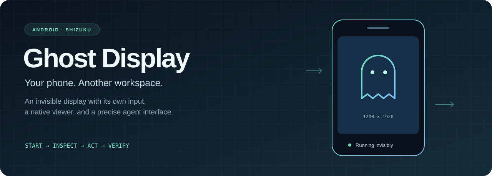
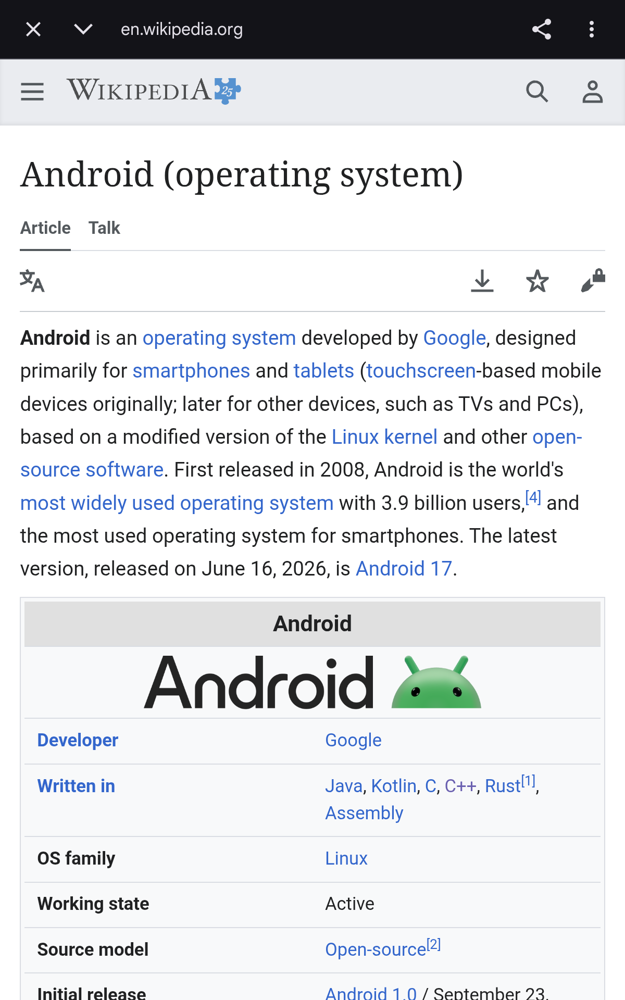
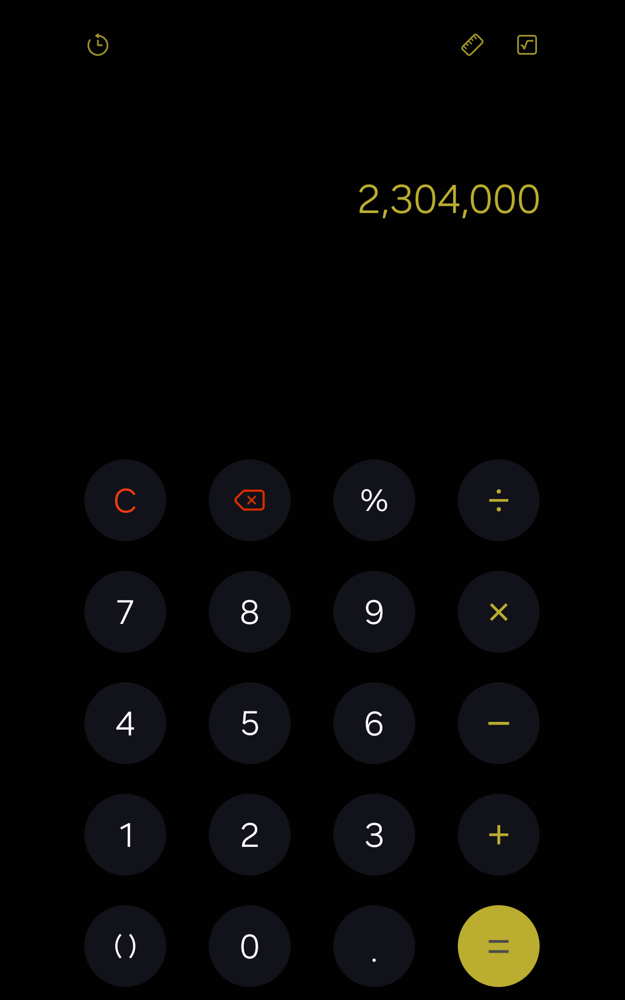
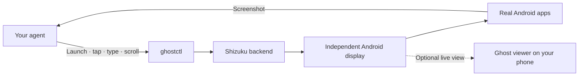
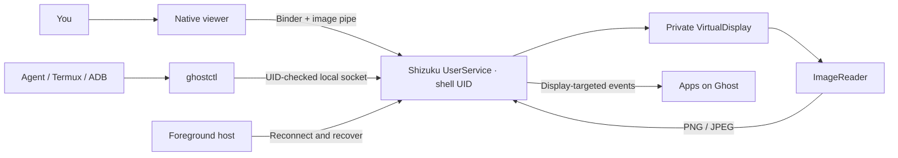

<p align="center"></p>

<p align="center">
  
  
  
  <a href="https://github.com/gitWRLD999/ghost-display/actions/workflows/android.yml"></a>
</p>

**Give your agent a second Android screen.** Ghost runs real apps on an independent display inside your phone. An agent reads screenshots, taps controls, types, scrolls, and checks the result through `ghostctl`. Your physical screen remains a separate workspace; open Ghost's native viewer when you want to see what the agent is doing.

Built and tested on a **Samsung Galaxy Z Fold7 with Android 16 / One UI 8.5**. Package: `com.vertex.ghost`.

> **Preview status:** Ghost 1.1 passed a 5-minute-40-second locked/off test with a real app, plus automatic backend recovery and cleanup checks on the Fold7. Other devices and overnight endurance remain unverified. [Read the measured results](docs/TEST_RESULTS.md).

<p align="center"><a href="#get-started">Get started</a> · <a href="docs/CLI.md">CLI reference</a> · <a href="docs/ARCHITECTURE.md">Architecture</a> · <a href="docs/TEST_RESULTS.md">Device tests</a> · <a href="docs/RECOVERY.md">Recovery</a></p>

## Real apps. A separate screen.

These are real captures from the installed Ghost backend. The agent navigated Chrome and completed a calculation in Samsung Calculator while the phone's physical screen was locked/off.

| Browse with Chrome | Use Samsung Calculator |
| --- | --- |
| <a href="docs/SHOWCASE.md"></a> | <a href="docs/SHOWCASE.md"></a> |

[Follow the agent's actions and see the before/after captures →](docs/SHOWCASE.md)

## What you get

| Capability | Behavior |
| --- | --- |
| Invisible workspace | Private 1200 × 1920 display, with no simulated-display overlay or mirroring. |
| Independent input | Every touch and key event carries Ghost's display ID. Physical focus stays on the phone. |
| Native viewer | Fit-to-screen rendering, mapped taps/swipes, text entry, Back, Home, Rotate, and Hide. |
| Agent interface | JSON commands, PNG/JPEG screenshots, full resolution or faster scaled capture. |
| Recovery | A foreground host reconnects to Shizuku and recreates the display when desired. |
| Explicit lifecycle | Repeated start reuses the display; stop releases its surface, wake locks, and privileged backend. |

## How an agent uses it

Ghost provides the screen and controls; connect it to an agent that can inspect images and run commands. The agent chooses its next action from the screenshot, then captures another frame to verify the result.



The second display uses your existing Android apps. It is not a second Android installation or a separate account sandbox.

Agents should start with the [operating protocol](docs/AGENT_PROTOCOL.md).
The [experimental Artemis adapter](integrations/artemis/README.md) provides a
Ghost-only action backend; its current validation status and runtime limitations
are documented separately from the phone acceptance results.

## Get started

1. Install the APK from the private [Releases page](https://github.com/gitWRLD999/ghost-display/releases).
2. Start Shizuku using your normal setup.
3. Open **Ghost Display**, tap **Start**, and allow Shizuku access. Allow notifications for the viewer shortcut.
4. Tap **Test** to try the controls, or launch an app with `ghostctl`.
5. Use **Hide** to return to the physical phone. Use **Stop** when you want to release Ghost.

The launcher icon, foreground notification, and optional **Ghost Viewer** Quick Settings tile open the same viewer. Ghost never opens the viewer automatically.

### USB / PC workflow

Install the small launcher once:

```sh
adb push cli/ghostctl /data/local/tmp/ghostctl
adb shell sh /data/local/tmp/ghostctl start
adb shell sh /data/local/tmp/ghostctl status --json
adb shell sh /data/local/tmp/ghostctl open-url https://example.com
```

On PowerShell 7, the wrapper preserves binary screenshots and treats `--out` as a **PC path**:

```powershell
./cli/ghostctl.ps1 -Serial YOUR_USB_SERIAL start
./cli/ghostctl.ps1 -Serial YOUR_USB_SERIAL screenshot --out ./frame.png
./cli/ghostctl.ps1 -Serial YOUR_USB_SERIAL tap 600 400
./cli/ghostctl.ps1 -Serial YOUR_USB_SERIAL text 'Hello from an agent'
./cli/ghostctl.ps1 -Serial YOUR_USB_SERIAL stop
```

`-Adb` accepts an explicit ADB executable path. `ANDROID_SERIAL` supplies the default device selection. No computer name or device serial is embedded in the scripts.

### Termux / rish workflow

Copy `cli/ghostctl-rish` to `~/bin/ghostctl` and make it executable. It uses `rish` on PATH, then `~/.local/bin/rish`, or an explicit `RISH` environment variable. The Android launcher above must also be installed.

```sh
ghostctl start
ghostctl open-app com.android.chrome
ghostctl screenshot --out /sdcard/Download/ghost.png
ghostctl text "Hello from Termux"
ghostctl viewer
```

Normal runtime needs Shizuku, not a PC connection or localhost ADB port 5555. Starting Shizuku again after a reboot is a separate requirement of the phone's Shizuku setup.

## How it fits together



The backend uses a real `com.android.shell` package context. It owns the display, input, capture, and wake locks. The viewer reads copied frames and never takes over the display's surface. No Accessibility service is required.

## Build and verify

Requirements: JDK 17+ (JDK 21 used locally), Android SDK 36, Build Tools 36.0.0. Gradle 8.13 and AGP 8.13.0 are pinned.

```sh
./gradlew clean assembleDebug
```

On Windows, this also verifies the APK signature:

```powershell
./scripts/build.ps1
```

Set `GHOST_KEYSTORE` to the original signing key when building an update. Optional signing variables are documented in [development](docs/DEVELOPMENT.md). CI builds use an ephemeral debug key; those artifacts are for verification and do not replace the signed release APK.

The real-device [smoke test](scripts/smoke.ps1) checks focus isolation, separate text fields, tap/long press/swipe/key input, valid screenshots, repeated capture, and idempotent start. It intentionally starts a fresh Ghost session and opens a physical test activity.

```powershell
./scripts/smoke.ps1 -Serial YOUR_USB_SERIAL -Evidence ./ghost-test-results
```

## Boundaries to understand

- Ghost is a separate display in the **same Android user**. Apps share accounts, files, and app data with their physical-display instances.
- Some single-instance apps may reuse or move an existing task. Chrome and the included test activity were exercised; arbitrary apps are not guaranteed.
- Text uses Android's virtual keyboard mapping. Unsupported Unicode returns an explicit error before injecting any text.
- The display survives closing the viewer. Backend death recreates a fresh display; unsaved app UI state is not guaranteed to survive.
- `home` opens Ghost's blank workspace. Global power, sleep, wake, and Home key codes are rejected by the agent API.
- Protected/DRM content can render black. `dump` reports display-scoped window state, not an Accessibility tree.
- Ghost creates a real VirtualDevice with an independent display group. It refuses to start if that group is unavailable; compatibility with other OEM firmware has not been established. See [device tests](docs/TEST_RESULTS.md).

## Repository map

```text
app/                 Android viewer, lifecycle host, shell backend, and test fixture
cli/                 Android, PowerShell, and Termux/rish launchers
scripts/             Build verification and real-device test tools
docs/                Architecture, API, recovery, and measured test results
AGENTS.md            Start → inspect → screenshot → act → verify → recover → stop
```

This repository is private. No redistribution license has been selected. Signing keys, private app backups, full phone diagnostics, and device identifiers are intentionally excluded.
