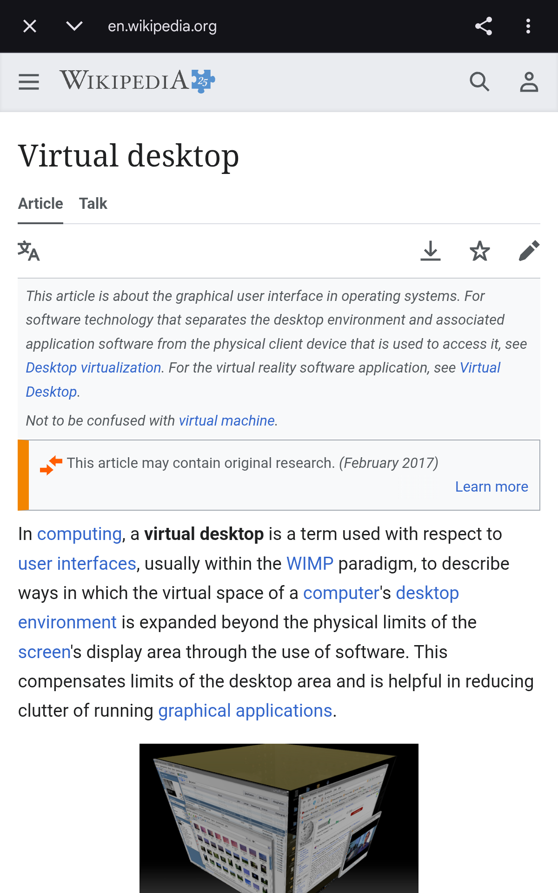
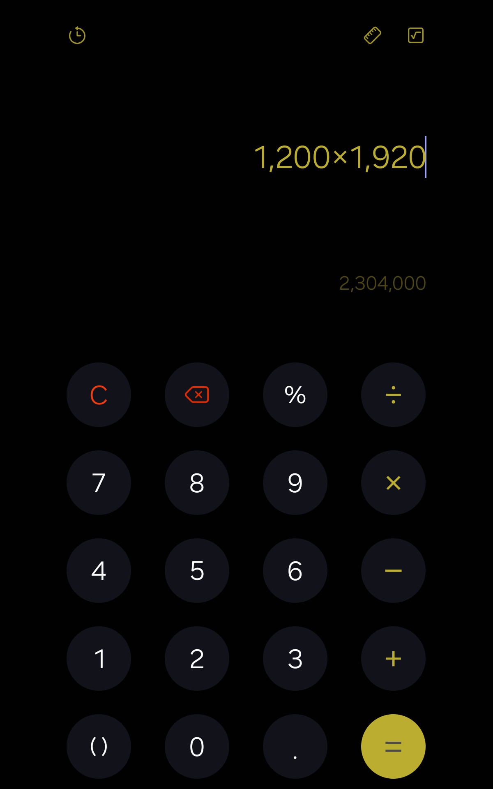
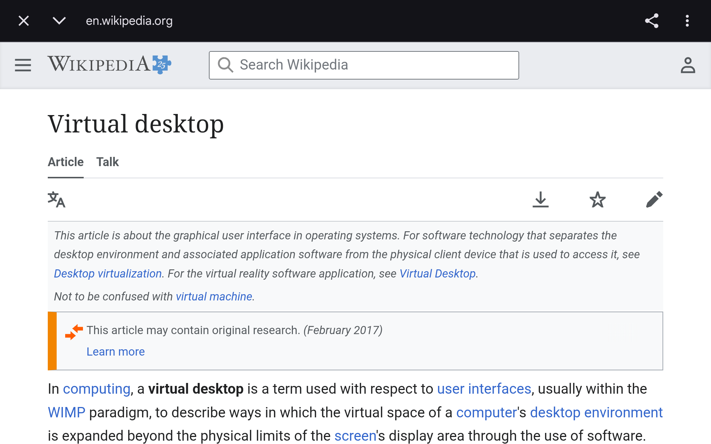

# An agent using a real second screen

These are actual Ghost captures from the Fold7 on September 18, 2026. The agent used screenshots and display-targeted controls to navigate Chrome and operate Samsung Calculator. The installed Ghost 1.1 Shizuku backend owned the display; no disposable display probe supplied these frames.

## Browse and act

Chrome opened a public Wikipedia article in a Custom Tab, keeping the user's existing tab strip out of view. The agent inspected the screen, tapped Wikipedia search, typed `Virtual desktop`, and pressed Enter. The next capture confirmed navigation to that article.

| Read a public page | Search using the app's controls |
| --- | --- |
|  |  |

The UI operations used the ordinary agent interface:

```sh
ghostctl screenshot --out /sdcard/Download/ghost-before.png
ghostctl tap 1033 174
ghostctl text 'Virtual desktop'
ghostctl key ENTER
ghostctl screenshot --out /sdcard/Download/ghost-after.png
```

Those coordinates belong to the captured 1200 × 1920 layout. An agent must inspect its current screenshot rather than reuse them after navigation or rotation.

For this privacy-conscious demo only, a small shell helper opened a Chrome Custom Tab with Android's standard session extra; subsequent control and capture used Ghost. Normal `ghostctl open-url URL` opens the default browser and may show its existing tabs. Custom Tabs are not an isolated account or cookie store. See the [demo helper](../experiments/GhostBrowserDemo.java) and the [AndroidX Custom Tabs implementation](https://android.googlesource.com/platform/frameworks/support/+/f237c83c45f885a4901d33d668a70767dc70d48e/browser/browser/src/main/java/androidx/browser/customtabs/CustomTabsIntent.java).

## Calculate while the phone is locked

The agent launched Samsung Calculator, inspected its controls, and entered `1200*1920`. With secure keyguard showing and both physical panels OFF, Ghost continued rendering for a measured 339.68 seconds. The agent then tapped Equals and captured the result: **2,304,000 pixels**.

| Enter the expression | Complete it after the locked/off interval |
| --- | --- |
|  |  |

```sh
ghostctl open-app com.sec.android.app.popupcalculator
ghostctl text '1200*1920'
# After the measured locked/off interval:
ghostctl tap 958 1817
ghostctl screenshot --out /sdcard/Download/calculator-result.png
```

## Resize the workspace

`ghostctl rotate` resized the same display to 1920 × 1200 while locked. Chrome redrew its page in landscape; returning to portrait retained the display ID.



## What the captures establish

These demonstrate real app rendering, screenshot-based control, browser navigation, hardware-key text entry, and a fresh Calculator action after a short locked/off interval. They do not establish compatibility with every app, overnight endurance, or preserved tasks after a backend crash. The screen-off measurement is recorded in [device tests](TEST_RESULTS.md); screenshots alone do not show the physical phone's power state.

Every published frame was visually inspected. There are no personal tabs, account names, messages, notifications, location banners, or device identifiers in these captures. The calculation and search query were chosen for the demo. A location-based web banner was dismissed in the browser before the published capture; image pixels were not retouched. Unreviewed captures and raw diagnostics remain outside this repository.

Public page content is from Wikipedia contributors: [Android (operating system)](https://en.wikipedia.org/wiki/Android_(operating_system)) and [Virtual desktop](https://en.wikipedia.org/wiki/Virtual_desktop). Wikipedia text is available under [CC BY-SA 4.0](https://creativecommons.org/licenses/by-sa/4.0/); individual media may have separate terms listed on their source pages. Chrome, Android, Wikipedia, and Samsung marks and application interfaces belong to their respective owners. Their appearance does not imply endorsement.
